# Streak

The current run, the longest run, and the contribution total.

Mini is the current run. Compact puts the current run and the longest run side by side. Regular and wide add the total, in three columns.

An SVG for a GitHub profile. Place the URL in a README, on a site, or anywhere an image is allowed.

## Contents

- [Usage](#usage)
- [Themes](#themes)
- [Sizes](#sizes)
- [Parameters](#parameters)
- [Examples](#examples)
- [Generate files](#generate-files)
- [Run locally](#run-locally)
- [Deploy](#deploy)
- [Configuration](#configuration)
- [Private data](#private-data)
- [Contributing](#contributing)

## Usage

```text
https://github.com/itsrealkaran/nothing-github-streak?username=itsrealkaran
```

```md

```

Leave `theme` and `size` off for the classic regular card. It has a hairline border and a small corner. An unknown username, theme, or size still returns an SVG, so the image slot in a README stays intact.

## Themes

| Theme | Background | Mark |
| --- | --- | --- |
| `classic` | Pure Black `#000000` | white |
| `classic-r` | Pure Black `#000000` | N-Red `#C8102E` |
| `white` | Pure White `#FFFFFF` | black |
| `white-r` | Pure White `#FFFFFF` | N-Red `#C8102E` |
| `light` | N-Grey `#DCD7D2` | N-Red `#C8102E` |
| `red` | Pure Black `#000000` | N-Red `#C8102E` |
| `blue` | Pure White `#FFFFFF` | N-Blue `#002F6C` |
| `yellow` | Pure Black `#000000` | N-Yellow `#FFC700` |

The current number is a dot grid. The total, the longest run, and the labels stay monospace.

## Sizes

| Size | Dimensions | Contents |
| --- | --- | --- |
| `mini` | 220×148 | The current run, with its dates. |
| `compact` | 495×168 | The current run and the longest run. |
| `regular` | 440×195 | The same three columns, larger. Default. |
| `wide` | 896×220 | The same three columns, larger again. |

The files in `dist/` use the theme name, then the size: `classic-regular.svg`.

## Parameters

| Parameter | Required | Default | Purpose |
| --- | --- | --- | --- |
| `username` | yes |  | GitHub login. `user` is the same parameter. |
| `theme` | no | `classic` | One of the themes above. |
| `size` | no | `regular` | One of the sizes above. |
| `border` | no | `1` | `0` removes the border and uses the rounder corner. |

## Examples

Previews use `itsrealkaran`.

### classic

#### mini

`https://github.com/itsrealkaran/nothing-github-streak?username=itsrealkaran&theme=classic&size=mini`

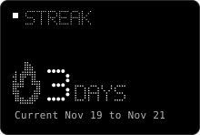

#### compact

`https://github.com/itsrealkaran/nothing-github-streak?username=itsrealkaran&theme=classic&size=compact`

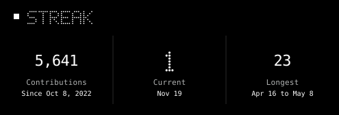

#### regular

This is the default. You can leave `theme` and `size` off and get this card.

`https://github.com/itsrealkaran/nothing-github-streak?username=itsrealkaran&theme=classic&size=regular`

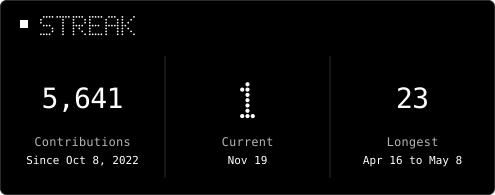

#### wide

`https://github.com/itsrealkaran/nothing-github-streak?username=itsrealkaran&theme=classic&size=wide`

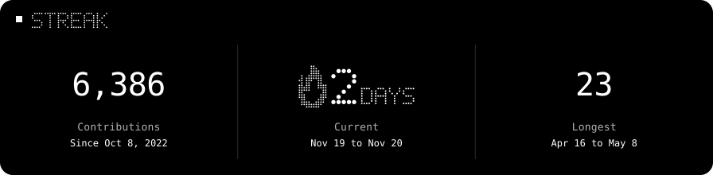

### classic-r

#### mini

`https://github.com/itsrealkaran/nothing-github-streak?username=itsrealkaran&theme=classic-r&size=mini`

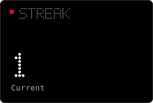

#### compact

`https://github.com/itsrealkaran/nothing-github-streak?username=itsrealkaran&theme=classic-r&size=compact`

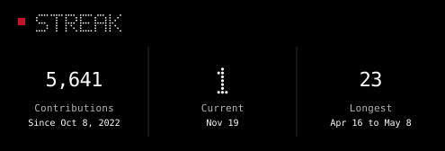

#### regular

`https://github.com/itsrealkaran/nothing-github-streak?username=itsrealkaran&theme=classic-r&size=regular`

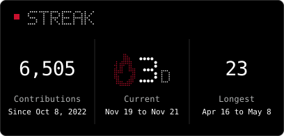

#### wide

`https://github.com/itsrealkaran/nothing-github-streak?username=itsrealkaran&theme=classic-r&size=wide`

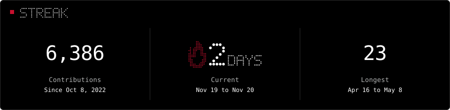

### white

#### mini

`https://github.com/itsrealkaran/nothing-github-streak?username=itsrealkaran&theme=white&size=mini`

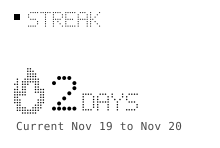

#### compact

`https://github.com/itsrealkaran/nothing-github-streak?username=itsrealkaran&theme=white&size=compact`


#### regular

`https://github.com/itsrealkaran/nothing-github-streak?username=itsrealkaran&theme=white&size=regular`

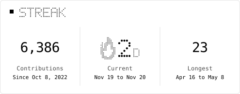

#### wide

`https://github.com/itsrealkaran/nothing-github-streak?username=itsrealkaran&theme=white&size=wide`

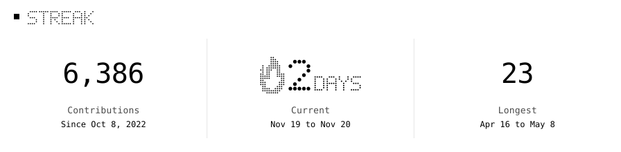

### white-r

#### mini

`https://github.com/itsrealkaran/nothing-github-streak?username=itsrealkaran&theme=white-r&size=mini`

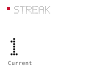

#### compact

`https://github.com/itsrealkaran/nothing-github-streak?username=itsrealkaran&theme=white-r&size=compact`

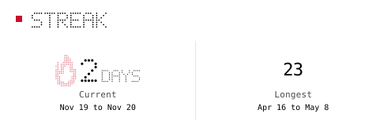

#### regular

`https://github.com/itsrealkaran/nothing-github-streak?username=itsrealkaran&theme=white-r&size=regular`

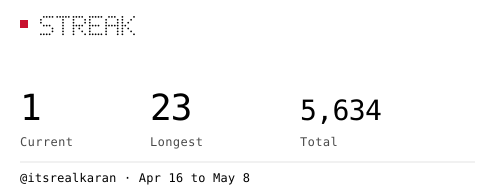

#### wide

`https://github.com/itsrealkaran/nothing-github-streak?username=itsrealkaran&theme=white-r&size=wide`

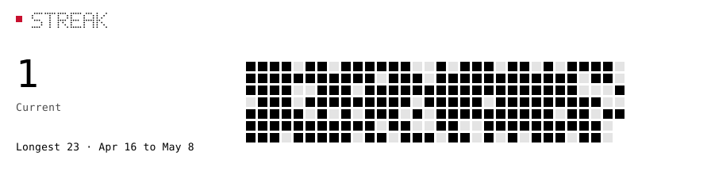

### light

#### mini

`https://github.com/itsrealkaran/nothing-github-streak?username=itsrealkaran&theme=light&size=mini`

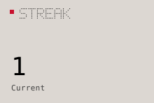

#### compact

`https://github.com/itsrealkaran/nothing-github-streak?username=itsrealkaran&theme=light&size=compact`

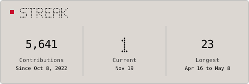

#### regular

`https://github.com/itsrealkaran/nothing-github-streak?username=itsrealkaran&theme=light&size=regular`

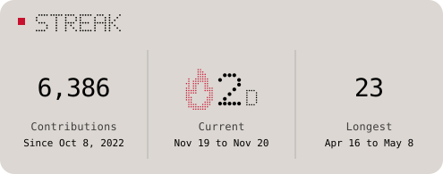

#### wide

`https://github.com/itsrealkaran/nothing-github-streak?username=itsrealkaran&theme=light&size=wide`

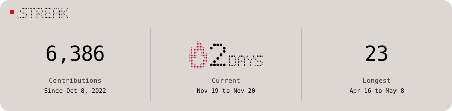

### red

#### mini

`https://github.com/itsrealkaran/nothing-github-streak?username=itsrealkaran&theme=red&size=mini`

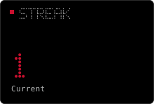

#### compact

`https://github.com/itsrealkaran/nothing-github-streak?username=itsrealkaran&theme=red&size=compact`

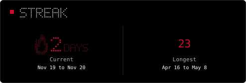

#### regular

`https://github.com/itsrealkaran/nothing-github-streak?username=itsrealkaran&theme=red&size=regular`

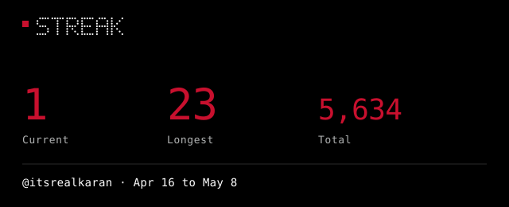

#### wide

`https://github.com/itsrealkaran/nothing-github-streak?username=itsrealkaran&theme=red&size=wide`

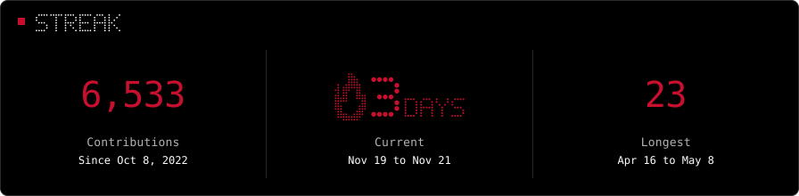

### blue

#### mini

`https://github.com/itsrealkaran/nothing-github-streak?username=itsrealkaran&theme=blue&size=mini`


#### compact

`https://github.com/itsrealkaran/nothing-github-streak?username=itsrealkaran&theme=blue&size=compact`

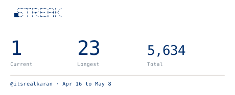

#### regular

`https://github.com/itsrealkaran/nothing-github-streak?username=itsrealkaran&theme=blue&size=regular`

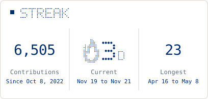

#### wide

`https://github.com/itsrealkaran/nothing-github-streak?username=itsrealkaran&theme=blue&size=wide`

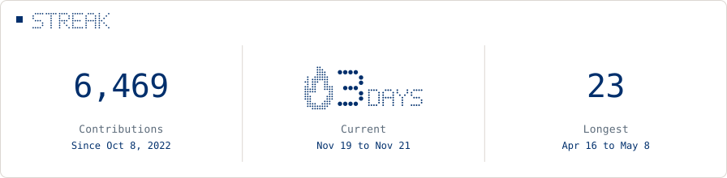

### yellow

#### mini

`https://github.com/itsrealkaran/nothing-github-streak?username=itsrealkaran&theme=yellow&size=mini`

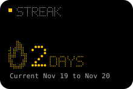

#### compact

`https://github.com/itsrealkaran/nothing-github-streak?username=itsrealkaran&theme=yellow&size=compact`

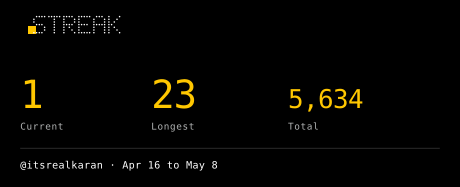

#### regular

`https://github.com/itsrealkaran/nothing-github-streak?username=itsrealkaran&theme=yellow&size=regular`


#### wide

`https://github.com/itsrealkaran/nothing-github-streak?username=itsrealkaran&theme=yellow&size=wide`

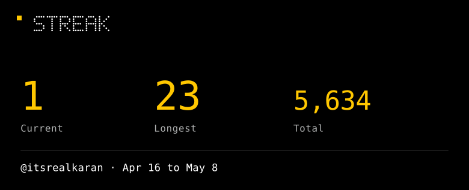

## Generate files

Write the SVG files into the repo when you want a fixed picture instead of a live URL.

```bash
python3 render.py itsrealkaran
```

Python 3 is enough. There is no package to install. Files land in `dist/<login>/`. Public numbers use `gh` when it is signed in on that machine, or `GH_TOKEN` / `GITHUB_TOKEN`.

## Run locally

The Python container and the Node server use the same path and the same query.

### Python container

```bash
docker build -t streak .
docker run --env GH_TOKEN --env PORT=8080 -p 8080:8080 streak
```

If the token is in a local `.env` file, pass that file instead:

```bash
docker run --env-file .env --env PORT=8080 -p 8080:8080 streak
```

The container runs `serve.py`. Open `http://127.0.0.1:8080/streak?username=itsrealkaran`.

The image does not include the `gh` command. Set `GH_TOKEN` when you start it. Without a token, GitHub allows about 60 requests an hour.

### Node

```bash
node server.js
```

The server listens on port `8080`. It reads `GH_TOKEN` from the environment, or from a `.env` file in this folder. `python3 render.py` remains the command that writes `dist/`.

Vercel and Netlify can host `server.js`. Set `GH_TOKEN` on the project. `vercel.json` is included. A free function has a short time limit. Use the Python container when a request needs longer than that limit.

## Deploy

Fork this repo for your own host. Your copy stays awake if a shared deploy sleeps, your traffic stays off a shared GitHub limit, and you can add a token for your own counts.

1. Fork the repo.
2. Deploy the Dockerfile on Fly, Railway, Render, Cloud Run, or a virtual machine. Or deploy `server.js` on Vercel or Netlify.
3. Set the variables below as secrets. Do not commit them.
4. Open `https://github.com/itsrealkaran/nothing-github-streak?username=yourname`.

Use that address in the image URL. The query stays the same.

## Configuration

| Variable | Required | Purpose |
| --- | --- | --- |
| `GH_TOKEN` | for a public server | GitHub token. `GITHUB_TOKEN` is the same variable. |
| `PORT` | no | Listen port. Default `8080`. |
| `CARD_CACHE_SECONDS` | no | How long a finished SVG is reused. Default `3600`. |

### Create a token

1. On GitHub, open Settings, then Developer settings, then Personal access tokens, then Tokens (classic).
2. Generate a new token.
3. Public cards need no extra scopes. The token raises the server limit from about 60 requests an hour to 5,000.
4. To include your own private counts, add the `repo` scope. The token account must match `username`.
5. Set the value as `GH_TOKEN` on the host. Do not put it in the image URL, this README, or git.

## Private data

A public card needs no token. The contribution total includes private days only when that person has turned private contributions on in their GitHub profile.

To include your own private days beyond that setting, set `GH_TOKEN` to a classic personal access token for the same account as `username`. Give that token the `repo` scope. Private repository names are never drawn.

## Contributing

This folder is the card: the drawing, the GitHub fetch, and both servers.

1. Fork the repo and edit `render.py`, or the files beside it when the change is the data or the colours.
2. Draw a sample with `python3 render.py yourname` and open `dist/yourname/`.
3. The live routes use that same drawing.
4. Do not commit a token, a `.env` file, or a private repository name.
5. Open a pull request and name the theme and size you checked.
